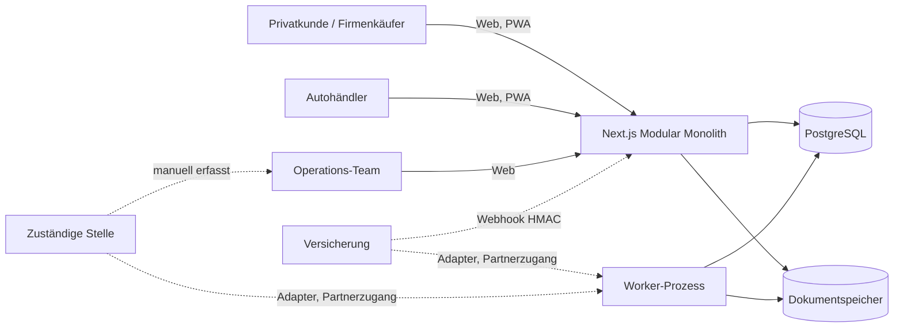
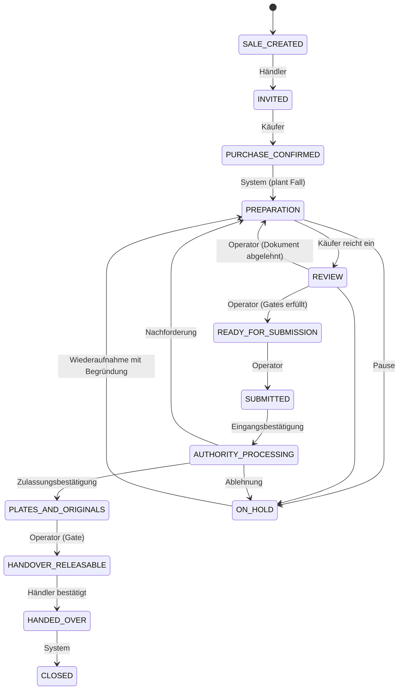

# 02 · Architektur

## Systemkontext



Der Modular Monolith läuft als eine Next.js-Anwendung. Ein separater Worker-Prozess führt Aufgaben aus.
Externe Dienste sind hinter Adaptern gekapselt und können später ausgelagert werden.

## Projektstruktur

```
src/
  app/                 Routen (App Router), Server Actions (actions.ts), API-Routen
  auth/                policy.ts (reine Berechtigungsregeln), actor.ts (Next), session.ts (Cookie)
  components/          UI-Bausteine, Fallansicht, Formulare
  content/             Texte des öffentlichen Auftritts
  domain/              Reine Fachlogik ohne Datenbank: Zustandsmaschine, Gates, Regel-Engine, VIN, Klassifikation, Zeitleiste
  adapters/            Versicherung, Behörde, OCR, Speicher, Malwarescan, E-Mail (mit Demo-/Nicht-Integriert-Kennzeichnung)
  services/            Anwendungsfälle mit Transaktionen: Fall-Kern, Verkauf, Dokumente, Versicherung, Behörde, Worker, Lesemodelle
  lib/                 Konfiguration, Datenbank, Fehler, Sicherheit (Hashing, Tokens, Rate Limit)
prisma/                schema.prisma, versionierte Migrationen, seed.ts (Demo-Daten)
scripts/worker.ts      Hintergrundprozess
tests/unit/            Domänenlogik (28 Tests)
tests/integration/     Gegen PostgreSQL: Mandantentrennung, Workflow, Resilienz (34 Tests)
e2e/                   Playwright, Desktop und Mobile (22 Tests)
docs/                  Dokumentation
```

Abhängigkeitsregel: `domain` importiert nichts aus `services`, `adapters` oder Next. `services` kennt keine Darstellung.
Die Oberfläche spricht nur über Server Actions und Lesemodelle mit den Services.

## Zustandsmaschine des Zulassungsfalls



Die Matrix `GRAPH` und `ACTORS` in `src/domain/case-state.ts` ist die einzige Quelle. Unzulässige Übergänge und nicht berechtigte
Parteien werden abgelehnt (`InvalidTransitionError`). Jeder Übergang läuft in einer Transaktion mit optimistischer Sperre (`version`),
schreibt eine `WorkflowEvent`-Zeile und einen Audit-Eintrag.

Die Übergänge nach `READY_FOR_SUBMISSION`, `HANDOVER_RELEASABLE` und `HANDED_OVER` prüfen zusätzlich die Gates aus `src/domain/gates.ts`.

## Freigabe-Gates

- **Einreichung:** Prozessbestätigung vorhanden, keine offenen Anforderungen, Versicherung bestätigt, keine offenen Prüfungen, Fall nicht pausiert.
- **Übergabe:** wie Einreichung, zusätzlich behördliche Zulassungsbestätigung oder vorläufige Berechtigung.
  - `RELEASED`: alle Quellen real (Partner oder Operator mit Beleg).
  - `DEMO_SIMULATED`: alle Bedingungen erfüllt, aber mindestens eine Quelle ist Simulation. Die Oberfläche zeigt dann keine Freigabe.
  - `BLOCKED`: Blocker werden aufgelistet.
- Im Produktivbetrieb (`APP_ENV=production`) wird `DEMO_SIMULATED` nicht zur Übergabe akzeptiert. Simulationen sind dort ohnehin gesperrt.

## Anforderungen und Regel-Engine

Regeln sind Daten (JSON in `CantonRuleset`, versioniert). Die Engine (`src/domain/rules/engine.ts`) wertet Bedingungen über Fallmerkmale aus:
Fallart, Kontrollschildsituation, Neuwagen, bisherige Zulassung, Firmenkäufer, Import.

- Jede Regel trägt `verified`, `sourceRef` und eine Notiz. Nicht verifizierte Regeln erzeugen beim Planen einen offenen Prüfauftrag.
- Jede Anforderung speichert `ruleKey`, `verification` und den Regelwerk-Verweis. Ein Fall behält damit seine Grundlage, auch wenn später eine neue Regelversion gilt.
- Anforderungen mit Dokumentart werden nur durch einen **verifizierten** Beleg erfüllt. Keine manuelle Abhaken-Option.

## Datenmodell

Kernentitäten (Prisma, PostgreSQL, UUIDs, Fremdschlüssel, Unique-Indizes):

- Identität: `User`, `Session`, `Organization`, `OrganizationMember`, `CustomerProfile`
- Fahrzeug und Verkauf: `Vehicle` (Unique je Organisation und VIN), `VehicleSale`, `PurchaseConfirmation`
- Fall: `RegistrationCase` (Version, Status, Regelwerk-Verweis), `CantonRuleset`, `CaseRequirement`
- Dokumente: `Document`, `DocumentVersion` (SHA-256, Speicherschlüssel), `DocumentExtraction`, `DocumentExtractionField` (Konfidenz, Status)
- Versicherung: `InsuranceProvider`, `InsuranceRequest`, `InsuranceStatusEvent`
- Behörde: `AuthoritySubmission`, `AuthorityResponse` (Unique je Quelle und externer Ereignis-ID), `TemporaryAuthorization`
- Workflow: `WorkflowTask` (Unique Idempotenzschlüssel, Versuche, Dead Letter), `WorkflowEvent` (Statushistorie), `ReviewItem`, `WebhookEvent` (Unique je Anbieter und Ereignis-ID)
- Plattform: `Notification`, `AuditLog`

Bewusst noch nicht modelliert: Zahlungen, Rechnungen, Einwilligungsverwaltung als eigene Tabelle (die Einwilligung steht in `PurchaseConfirmation`),
Flottenfreigaben, Kontrollschild-Zuteilung als eigene Entität.

## Workflow-Engine

- **Aufgaben** entstehen beim Planen (Versicherungsanfrage) und bei der Einreichung (Behördenübermittlung). Der Idempotenzschlüssel verhindert Doppelungen.
- **Worker** (`npm run worker`) beansprucht fällige Aufgaben atomar (PENDING → RUNNING). Mehrere Worker sind möglich.
- **Fehlerklassen:** `TRANSIENT_ERROR` wird mit exponentiellem Backoff wiederholt. Nach `maxAttempts` landet die Aufgabe in `DEAD_LETTER` und erzeugt eine Prüfung.
  `NOT_INTEGRATED` ist kein Fehler, sondern ein manueller Weg. Die Daten bleiben im Einreichungsprotokoll erhalten.
- **Hängende Aufgaben** (Worker abgestürzt) werden nach 10 Minuten wieder freigegeben.
- **Erneute Ausführung** durch das Team nur mit Begründung, im Workflow und Audit-Log protokolliert.
- Im MVP läuft die Warteschlange über PostgreSQL. Redis und BullMQ sind für die Skalierung vorgesehen (siehe 06).

## Ereignisverarbeitung

- **Versicherung:** `POST /api/webhooks/insurance`. Signatur: `X-AutoPass-Signature: sha256=<HMAC-SHA256 des Rohkörpers>`, Vergleich in konstanter Zeit.
  Doppelte Zustellung erkennt der Unique-Index auf `(provider, externalEventId)`. Die Transaktion wird zurückgerollt, nichts wird doppelt geschrieben.
  Im Demo-Modus wird jedes Ereignis als `SIMULATION` gespeichert.
- **Behörde:** Erfassung durch das Team mit Referenz. Partnerereignisse folgen demselben Pfad über `recordAuthorityResponse` (ohne Schnittstelle nicht aktiv).

## Sicherheitskonzept (Stand MVP)

| Thema | Umsetzung | Lücke vor Produktion |
|---|---|---|
| Passwörter | scrypt (N=16384, r=8, p=1), Salt je Passwort | Passwort-Richtlinie erweitern, Kompromittiertprüfung |
| Sessions | Zufalls-Token, nur SHA-256-Hash in DB, HttpOnly, SameSite=Lax, Secure in Produktion, 12 h | Erneuerung, Abmeldung aller Geräte |
| Anmeldeschutz | Rate Limit 10 Versuche je 15 min je E-Mail und Client, neutrale Fehlermeldung | Redis-basiertes Limit für mehrere Instanzen |
| MFA | Nicht umgesetzt | Pflicht für Operator und Administrator |
| Autorisierung | Mandantenprüfung je Objekt (`canAccessCase`, `assertOrgMember`), fremde IDs als „nicht gefunden“ | Zusätzliche Tests pro Endpunkt |
| CSRF | Server Actions mit Origin-Prüfung durch Next.js | – |
| XSS / Injection | React-Escaping, Prisma-Parameter, Zod-Validierung, CSP im Header | CSP ohne `unsafe-inline` mit Nonces |
| Uploads | Grösse (10 MiB), Dateikennung (Magic Bytes), Deklaration muss passen, zufälliger Speicherschlüssel | Malwarescan (ClamAV) vor Freigabe |
| Downloads | Nur über authentifizierte Route, `no-store`, `nosniff`, `attachment` | Signierte, kurzlebige URLs bei S3 |
| Webhooks | HMAC-SHA256, Idempotenz, Größenlimit | Partnerspezifische Schlüssel, Rotation |
| Verschlüsselung | TLS am Reverse Proxy (Betrieb) | Verschlüsselung sensibler Felder und Speicher-at-rest |
| Audit | Jede Statusänderung, Entscheidung und Dokumentänderung mit Benutzer und Zeit | Aufbewahrungs- und Löschregeln |
| Geheimnisse | Nur über Umgebungsvariablen, nicht im Repo | Secret-Manager |
| Demo-Schutz | `APP_ENV=production` verbietet `DEMO_MODE` beim Start | – |

## Frontend

- Next.js App Router, React 19, Tailwind CSS 4, Lucide-Icons, eigene Bausteine im Stil von shadcn/ui (ohne CLI-Generierung).
- Formulare: native Formulare mit Server Actions, Validierung mit Zod, Feldfehler am Eingabefeld.
- Mobile-first: untere Tab-Leiste auf dem Smartphone, Seitenleiste ab Tablet. Helle und dunkle Farbtokens.
- Keine Ausgabe von Zustand im Browser-Speicher. Der Fallstatus kommt immer vom Server.
